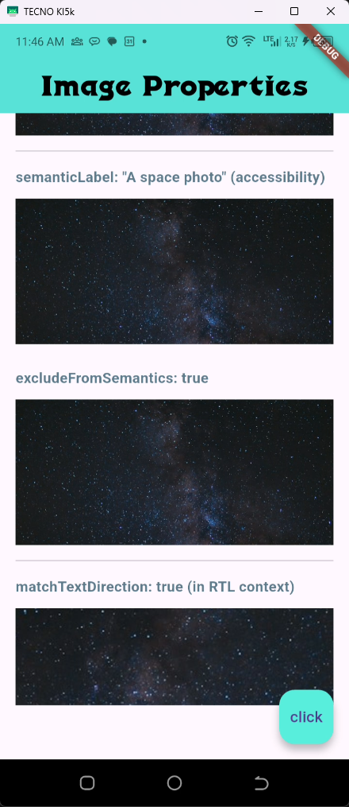

# image_widget - Flutter Image Widget presentation

## Description

This project contains dart code which contains a general setup of a scaffold flutter app with an intention of showing the **Image widget**, **its properties** and how it is illustrated.

## Getting Started

To start the project:
- Plug in your physical phone or 
- List your emulators by `flutter emulators` and then Start it up in your IDE with `flutter emulators --launch <emulator_name>`
- Run the app by either `flutter run` or `flutter run -t lib/main.dart`
- Navigate through the app after the build is done

## UI Showcase
Here is the current app UI:

 

## Author: Robert Niyonkuru
